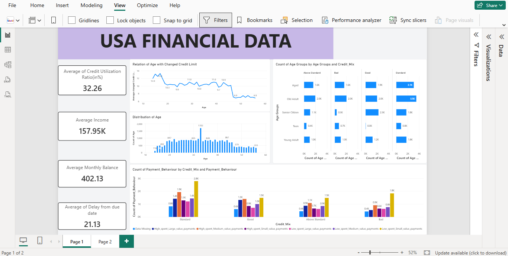
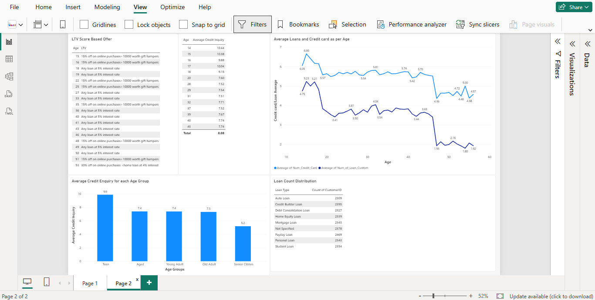

# Financial Data Automation & Credit Score Analytics

## 📌 Project Overview

This project automates a daily financial-data workflow that was previously dependent on manual file collection, consolidation, cleaning, and dashboard preparation.

The business process receives approximately **25 files every day at around 3 PM** from survey teams working across different locations. The objective is to make the data available for analysis and reporting within the same working day.

The automated solution connects:

**Outlook → Power Automate → Google Drive → Python + Google Drive API → Power BI → Power BI Service**

The final Power BI report can then use scheduled/automatic refresh in Power BI Service so that the published dashboard stays up to date.

---

## 🎯 Business Problem

The original workflow involved:

1. Downloading daily files from email.
2. Combining individual files into one consolidated dataset.
3. Cleaning and transforming the data.
4. Building/updating the Power BI dashboard.
5. Sharing the final analysis and insights with the client.

### Key challenges

- **Time consumption:** A significant amount of time was spent downloading, combining, and cleaning files.
- **Additional cost:** Two additional employees were hired, resulting in an additional cost of approximately **$12,000 per month**.
- **Data-manipulation errors:** Manual processing introduced errors and rework.
- **Workload:** The additional operational work affected other projects.

---

## 💡 Proposed Solution

The workflow was redesigned as an automated pipeline.

### End-to-end flow

```text
Survey Team
     │
     ▼
 Microsoft Outlook
     │
     │  Email containing "Credit Score"
     ▼
 Power Automate
     │
     │  Filter email / process attachments
     ▼
 Google Drive
     │
     │  Dedicated project folder
     ▼
 Python + Google Drive API
     │
     │  Access files
     │  Download data
     │  Read CSV / Excel / Google Sheets
     │  Combine datasets
     ▼
 Power BI
     │
     │  Data cleaning
     │  Transformation
     │  Data modelling
     │  Visualization
     ▼
 Power BI Service
     │
     │  Scheduled / automatic refresh
     ▼
 Updated Financial Dashboard
```

---

## ⚙️ Automation Workflow

### 1. Outlook

Incoming emails containing the keyword **"Credit Score"** are identified and routed for processing.

### 2. Power Automate

Power Automate handles the email-processing workflow.

The flow:

```text
When a new email arrives
        ↓
Apply to each attachment
        ↓
Condition / file validation
        ↓
Create file in Google Drive
```

This removes the need to manually download each attachment.

### 3. Google Drive

Google Drive acts as the central staging location for the incoming files.

The project uses a dedicated folder for the financial-data pipeline.

> **Security note:** The actual Google Drive folder ID and credentials are intentionally not included in this repository.

### 4. Python + Google Drive API

Python connects to Google Drive through the Google Drive API.

The ingestion process is responsible for:

- Authenticating with Google Cloud credentials.
- Connecting to Google Drive.
- Identifying files in the target folder.
- Downloading supported files.
- Reading CSV, Excel, and Google Sheets data.
- Combining the available datasets into a consolidated Pandas DataFrame.

### 5. Power BI

After the data is made available, the normal Power BI workflow is performed:

- Data cleaning
- Data transformation
- Data modelling
- Dashboard development
- Financial/credit-score analysis
- Visualization of business insights

### 6. Power BI Service

The completed report is published to Power BI Service.

A scheduled/automatic refresh is configured so that the report can retrieve updated data at defined intervals rather than requiring the dashboard to be manually refreshed every day.

---

## 📊 Dashboard

The project includes a Power BI dashboard for analysing the processed financial data.






---

## 🛠️ Technology Stack

| Technology | Purpose |
|---|---|
| Microsoft Outlook | Receiving survey-team emails |
| Power Automate | Email filtering and attachment automation |
| Google Drive | Central staging/storage location |
| Google Drive API | Programmatic access to files |
| Python | Data ingestion and processing |
| Pandas | Data manipulation and consolidation |
| OpenPyXL | Excel file processing |
| Power BI | Data transformation, modelling and visualization |
| Power BI Service | Published dashboard and scheduled refresh |
| GitHub | Version control and project documentation |

---

## 📁 Project Structure

```text
Financial-Data-Automation-PowerBI/
│
├── README.md
├── .gitignore
├── requirements.txt
│
├── notebooks/
│   └── financial_data_ingestion.ipynb
│
├── power_automate/
│   └── flow_documentation.md
│
├── powerbi/
│   └── Financial_Credit_Score_Dashboard.pbix
│
└── docs/
    ├── architecture.png
    ├── power_automate_flow.png
    ├── dashboard_preview_1.png
    └── dashboard_preview_2.png
```


---

## 🔐 Security & Credentials

The project uses Google Drive API credentials to access the data files.

The following sensitive authentication information is **not included** in the public repository:

- Google Cloud service-account JSON files
- API keys
- Passwords
- Access tokens

Credentials are stored locally or accessed through environment variables.

Example:

```python
import os

SERVICE_ACCOUNT_FILE = os.getenv("GOOGLE_SERVICE_ACCOUNT_FILE")
FOLDER_ID = os.getenv("GOOGLE_DRIVE_FOLDER_ID")
```

---

## 🚀 Setup

### 1. Clone the repository

```bash
git clone https://github.com/Zaki-byte-786/Financial-Data-Automation-PowerBI.git
cd Financial-Data-Automation-PowerBI
```

Replace the repository URL above if the final GitHub repository name is different.

### 2. Create a virtual environment

```bash
python -m venv .venv
```

Windows:

```bash
.venv\Scripts\activate
```

### 3. Install dependencies

```bash
pip install -r requirements.txt
```

### 4. Configure Google Cloud credentials

Create/configure a Google Cloud service account with the required Google Drive API permissions.

Store the credential JSON file locally.

Do **not** upload it to GitHub.

Set the environment variable:

Windows Command Prompt:

```cmd
set GOOGLE_SERVICE_ACCOUNT_FILE=C:\path\to\service-account.json
```

PowerShell:

```powershell
$env:GOOGLE_SERVICE_ACCOUNT_FILE="C:\path\to\service-account.json"
```

Also configure the Google Drive folder ID locally:

```cmd
set GOOGLE_DRIVE_FOLDER_ID=YOUR_FOLDER_ID
```

### 5. Run the Python Notebook

Open the Python notebook located in the `notebooks/` folder:

```text
notebooks/financial_data_ingestion.ipynb
```

---

## 🔄 Power BI Refresh

After the report is published to Power BI Service, configure the appropriate dataset/semantic-model refresh schedule.

The intended workflow is:

```text
New files
   ↓
Outlook
   ↓
Power Automate
   ↓
Google Drive
   ↓
Python ingestion
   ↓
Power BI data source
   ↓
Power BI Service refresh
   ↓
Updated dashboard
```

The exact refresh frequency and gateway/connection configuration depend on the final Power BI data-source architecture.

---

## 📈 Expected Business Benefits

The solution is designed to:

### Reduce processing time

Automate repetitive file collection and consolidation.

### Reduce manual errors

Reduce repeated manual downloading, copying, and combining of files.

### Reduce operational cost

Reduce the amount of manual effort required for daily file processing.

### Reduce workload

Allow team members to focus on analysis and other projects rather than repetitive data preparation.

### Improve reporting timeliness

Move toward a workflow where updated data can flow into the reporting environment and the Power BI Service can refresh the published report automatically.

---

## 🔮 Future Improvements

Potential future enhancements include:

- Automated data-quality validation.
- Automatic rejection/quarantine of invalid files.
- Schema validation before ingestion.
- Duplicate-file detection.
- Error logging and alert emails.
- Monitoring of failed Power Automate runs.
- Automated notification when new data is successfully processed.
- More robust incremental data loading.
- Automated data-quality dashboards.

---

## 👤 Project Focus

This project demonstrates an end-to-end **data automation and business intelligence workflow** combining cloud file ingestion, workflow automation, Python data processing, and Power BI reporting.

<h2><a class="anchor" id="author--contact"></a>Author & Contact</h2>

**Mohammad Zaki**  
Data Analyst  
📧 Email: mohd123zaki@gmail.com  
🔗 [LinkedIn](https://www.linkedin.com/in/mohammad-zaki-a362721b3/) 